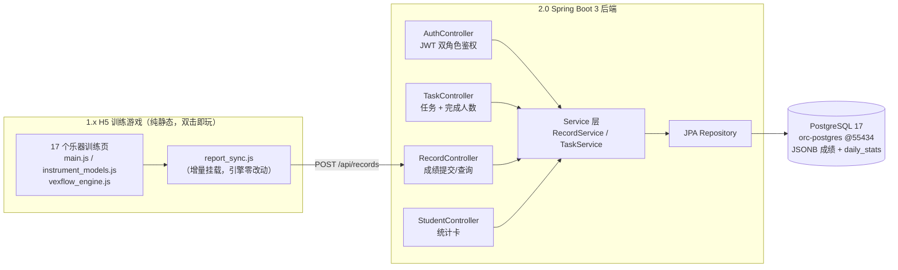

# 乐团识谱训练平台（Orchestra Sight-Reading Training）

一个自研的纯前端 H5 识谱训练游戏（1.x，乐团真实在用）+ 一个为它补上的 Spring Boot 3 后端（2.0）：
账号与 JWT 双角色鉴权（教师/学生）、班级与邀请码、训练任务下发、成绩 JSONB 持久化、每日统计——
**前端以增量脚本接入，原游戏引擎一行未改**。

> 一次真实训练的完整证据链（训练入口 → 结算报告 → 教师查询）与后端测试结果，见 [docs/](docs/) 与 [HANDOFF.md](HANDOFF.md)。

## 架构关系



```
1.x  H5 训练页（17 个乐器训练页，纯静态，双击 index.html 即玩）
      │  训练结束自动 POST（report_sync.js 增量挂载，游戏引擎零改动）
2.0  Spring Boot 3 后端（backend/）
      ├─ JWT 双角色鉴权（教师 / 学生）
      ├─ 班级 / 邀请码 / 训练任务下发
      ├─ 成绩 JSONB 持久化 + 每日统计
      └─ PostgreSQL 17（容器 orc-postgres，端口 55434，不占通用端口）
```

## 快速开始（2.0 后端，compose 三步）

前置：Docker Desktop 运行中。演示账号**仅用于本地演示环境**：教师 `teacher01/teacher123`、学生 `student01/student123`。

```powershell
# 1) 构建后端 jar（首次或代码变更后；在 backend/ 目录）
cd backend
docker run --rm -v "%cd%:/app" -v orc-m2:/root/.m2 -w /app docker.m.daocloud.io/library/maven:3.9-eclipse-temurin-21 mvn -s .mvn-settings.xml -DskipTests package

# 2) 一键启动 数据库 + 后端
docker compose up -d

# 3) 打开 2.0 控制台 http://localhost:8083/
#    打开 1.x 训练页：双击 index.html（或任意静态服务器）。
#    先用学生账号在同一浏览器登录控制台，report_sync.js 会把训练结算自动 POST 到 8083。

# 4) 停止/重启（数据保留在 orc-pgdata 卷）
docker compose down
```

**JWT 密钥**：后端从环境变量 `ORC_JWT_SECRET` 读取（compose 已透传 `APP_JWT_SECRET`）；未设置时使用内置**本地演示默认值**——生产部署必须显式设置。

## 测试

`mvnw test`：18/18 全绿（含真实 PG/pgvector 集成测试）。越权访问实测：学生 token 访问教师接口一律 403——
`ClosedLoopTest` 六用例把双角色边界全部锁死（**权限是测试里的断言，不是文档承诺**）。

## API 概览

| 方法 | 路径 | 说明 |
|---|---|---|
| POST | `/api/auth/login` | 登录（教师/学生双角色） |
| POST | `/api/tasks` | 教师发布训练任务（学生 403） |
| GET | `/api/tasks/progress` | 教师查询任务完成人数（学生 403） |
| POST | `/api/reports` | 学生提交训练结算（report_sync 自动调用） |
| GET | `/api/records` | 按学号/乐器/任务查询成绩（学生只能看自己） |
| GET | `/api/stats/{studentNo}` | 单学生统计卡（练习次数/平均分/最佳成绩） |

## 素材与许可（Asset credits）

**代码**：MIT License（见 [LICENSE](LICENSE)）——只覆盖本项目代码。

**音频**（明细见 [AUDIO_CREDITS.md](AUDIO_CREDITS.md)，全部本地打包、离线可用）：
- BGM `assets/audio/bgm-hub.mp3`（"Shufflin'"）与 `bgm-game.mp3`（"Slapstick"）—— Eric Matyas, www.soundimage.org（royalty-free）。
  **Required attribution: Music by Eric Matyas, www.soundimage.org.**
- 界面音效 ×4 —— [Kenney Interface Sounds](https://kenney.nl/assets/interface-sounds)（CC0）。
- `hit-brass / wrong-gliss / clear-fanfare` ×3 —— 本项目本地合成（CC0 / project-generated）。

**图片**：游戏内背景与指挥头像等插画为 **AI 生成素材**（生成提示词存档见 [GEMINI_ASSET_PROMPTS.md](GEMINI_ASSET_PROMPTS.md)），按生成服务条款由项目作者使用；`vexflow_engine.js` 为本项目自研的轻量 SVG 绘制引擎（文件名致敬 VexFlow，实际未使用其代码）。

## 二次开发边界（1.x → 2.0）

- 1.x 游戏本体以 `baseline-v1` 标签快照入库（`K:\KOUzi` 原目录零修改，42 文件与时间戳逐项核对一致）。
- 2.0 后端为新增模块；前端仅新增 `report_sync.js` 增量脚本挂载 17 个训练页，**原游戏引擎一行未改**。
- 本开发仓的完整提交历史（C1~C5）在内部开发存档中保留；本发布仓为公开白名单版本。

## 开发方式与 AI 协作声明

本项目 1.x 游戏为作者自研作品；2.0 后端由作者设计、并**与 AI Agent（Claude Code / Codex）协作开发**：
任务拆解、代码实现、测试编写与演示验证在 AI 协作下完成，全部提交与测试证据保留于内部开发存档（HANDOFF.md）。
仓库内容为作者本人所有并经人工验收；无上游仓库。

**GitHub Topics 建议**：`spring-boot` `jwt` `jsonb` `postgresql` `h5-game` `flyway` `sight-reading` `education-game`
